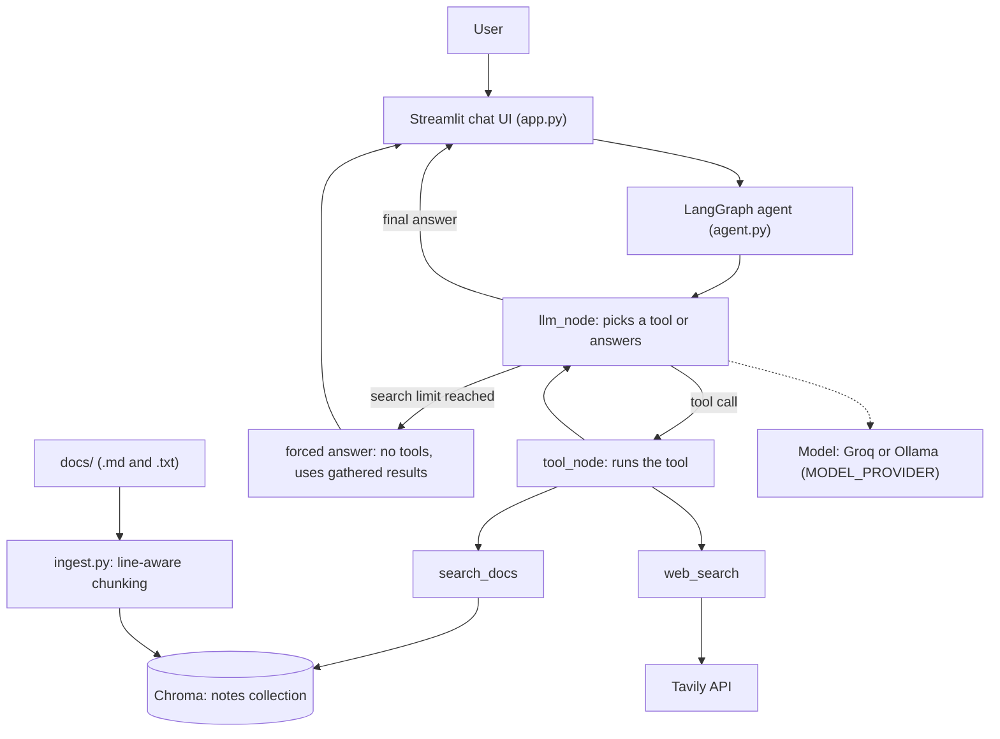

# Knowledge Agent

A chat assistant that answers questions from your own notes and, when needed, from the live web. It is built from scratch around a LangGraph agent loop, a Chroma vector store, and a Streamlit UI, and it runs on either a hosted model (Groq) or a local one (Ollama).

<!-- [YOU WRITE] Add a screenshot or a short GIF of the app here. -->

## What it does

- Answers questions about your own notes (`.md` and `.txt` files) and cites the file each answer came from.
- Searches the web for current information, using Tavily.
- Chooses between its two tools, or answers directly, depending on the question.
- Limits itself to two searches per question, then writes a final answer from what it found.
- Shows its tool calls and results in the UI, so you can see how an answer was produced.

## Architecture



## How it works

- **Ingest.** `ingest.py` reads every `.md` and `.txt` file in `docs/`, splits each into chunks of about 120 words along line boundaries (so a label always stays with its text), and stores them in a Chroma collection with the source file name as metadata. It rebuilds the collection from scratch on every run.
- **Retrieval is a tool.** The agent decides whether to call `search_docs`. It does not run on every question.
- **The loop.** The model either answers or requests a tool. The tool result goes back into the conversation, and the model decides again. The loop ends on a final answer or after two searches.
- **Forced answer.** After two searches, the model is called again with no tools attached and a separate prompt that tells it to answer only from the results it found, quote its evidence, and say so when the results do not answer the question.
- **Date awareness.** Today's date is added to the prompts, so the model can tell when a web source is old.
- **Error handling.** An invalid tool call from the model is caught and either answered from existing results or reported as an error. Other errors are not hidden.

## Setup

```bash
python -m venv venv
.\venv\Scripts\Activate.ps1        # PowerShell; use `source venv/bin/activate` on macOS or Linux
pip install -r requirements.txt
```

Copy `.env.example` to `.env` and fill in your keys:

| Variable | Purpose |
|---|---|
| `GROQ_API_KEY` | Hosted model (free tier works) |
| `TAVILY_API_KEY` | Web search (free tier works) |
| `MODEL_PROVIDER` | `groq` (default) or `ollama` |

For `ollama`, install [Ollama](https://ollama.com/) and run `ollama pull llama3.2:1b`.

## Run

```bash
python ingest.py          # build the notes collection from docs/
streamlit run app.py      # start the chat UI
```

Run `ingest.py` again whenever you change the files in `docs/`. To use your own notes, put them in `docs/` and rerun it. The sample notes in `docs/` (AI agents and computer networking) are only examples.

## Evaluation

`eval_questions.py` runs a fixed set of questions through the agent and checks each answer for required keywords and for whether the agent used a tool as expected. It reports passes, failures, known failures, and infrastructure errors separately, so a rate limit is never counted as a wrong answer.

```bash
python eval_questions.py
```

### Latest results

Run against the two sample notes, using Groq `openai/gpt-oss-120b` at temperature 0:

| Case | Result |
|---|---|
| Three steps of the TCP handshake | Pass |
| Which port HTTPS uses | Pass |
| What a 429 status code means | Pass |
| Stopping conditions for an agent loop | Pass |
| What quantization does | Pass |
| What routing is | Pass |
| Capital of France (should answer without a tool) | Pass |
| Latest stable Python version (needs the web) | Pass |

**8 passed, 0 failed, 0 known failures, 0 errors.**

Each case checks that the answer contains the expected keywords and that the agent used a tool, or did not, as expected.

### Freshness check

The question "What is the latest stable version of Python?" was run five times with the same settings (`python tally_python.py`):

| Outcome | Runs |
|---|---|
| Reported Python 3.15 | 4 |
| Reported the older 3.14 series | 1 |
| Errors | 0 |

Web search results change from run to run, even at temperature 0, so one correct run proves little. Several of the answers cited a general reference page and not python.org.

### What these results do and do not show

- The keyword checks confirm that the right words appear. They do not confirm that the answer means the right thing.
- Eight cases are a smoke test, not a benchmark.
- The case set does not test the weakness with labels and numbers described under Known limitations.
- The local model option (Ollama) was not evaluated in this project. An earlier comparison in a separate project found that a 1B model was unreliable at tool calling.

To reproduce: `python eval_questions.py` (about 5 minutes, because it pauses between questions to stay under the free-tier limit).

## Known limitations

- **Retrieval is weak on labels and numbers.** Embedding search ranks by meaning, so a question like "what is step 4 of the checklist" can miss the right chunk. Keyword (hybrid) search would fix it.
- **Ambiguous words can favour one file.** "Routing" means different things in the two sample notes, and the agent may answer with only one meaning.
- **Web results can be out of date.** Search engines rank by relevance, not freshness. The agent is told today's date and to check source dates, but it can still pick an old page.
- **Keyword checks cannot tell "do" from "do not".** The eval verifies that the right words appear. It does not check that the answer means the right thing.
- **The invalid-tool-call handler is Groq-specific.** Other providers raise different exceptions.
- **Free-tier token limits.** Groq's free tier limits tokens per minute, so large requests can be rejected. The eval pauses between questions to stay under it.
- **Follow-up context in the final answer.** The forced-answer step sees only the latest question, so a follow-up that depends on earlier turns works only on turns that did not reach the search limit.
- **Text files only.** PDFs and other formats are not supported.

## What I learned

<!-- [YOU WRITE] Two or three real bugs from this project and what each one taught you, in your own words. Candidates:
- The chunking overlap that was counted in lines but passed in words, producing 78 oversized chunks, and why printing min/avg/max chunk size caught it.
- The empty answer caused by a system prompt that told the model to search while it had no tools.
- The agent that cited a source it had inferred from, not read, and the date fix.
-->

## Project structure

```
knowledge-agent/
├── agent.py            # LangGraph agent, prompts, error handling
├── tools.py            # search_docs and web_search
├── ingest.py           # builds the Chroma collection from docs/
├── app.py              # Streamlit chat UI
├── ui_helpers.py       # formats the agent's steps for the UI
├── eval_questions.py   # regression questions
├── docs/               # your notes (samples included)
├── requirements.txt
└── .env.example
```

## License

MIT. See `LICENSE`.
